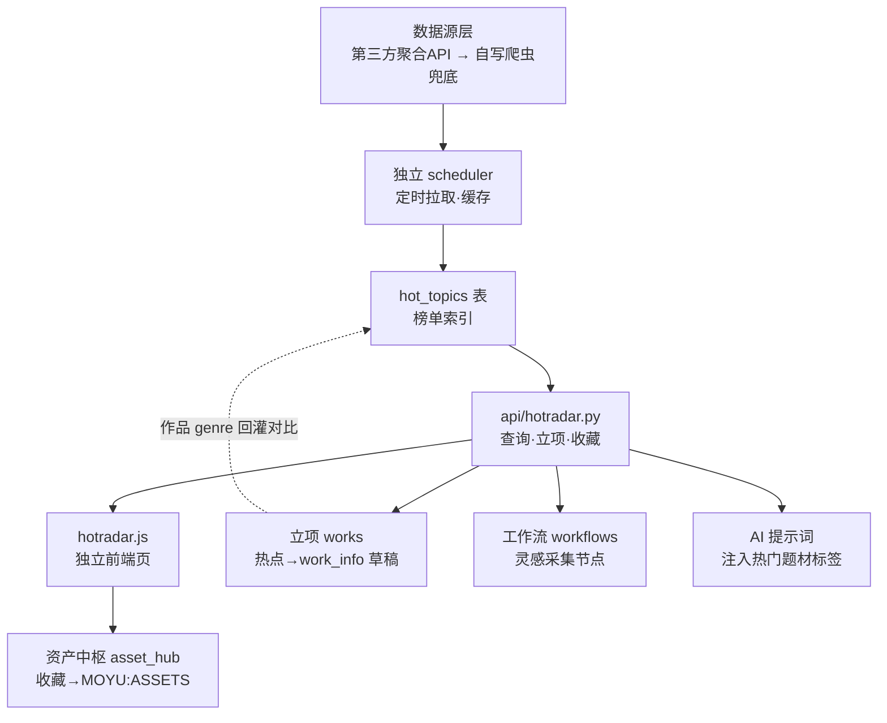

# 墨语 MoYu 热点雷达 开发计划

> 版本：v1.0（规划稿）
> 日期：2026-10-12
> 目标版本：v2.2.0（候选）
> 状态：规划确认 · 待实施
> 关联规范：`AGENTS.md`（全局约束）、`docs/墨语产物交付规范.md`（MOYU:ASSETS 契约 v1.0，现行唯一权威）
> 规划方式：经多轮提问确认所有关键决策后落盘，作为 Codex 接手实施的现行依据。

---

## 一、功能概述

**热点雷达**用于监测全网小说平台热点数据，帮助作者参考热门题材进行灵感创作。它不是一个孤立看板，而是嵌入墨语「创作流」P0 立项**之前**的「灵感源」，并把热点结构化为可流进现有创作模块的输入。

**目标**
1. 聚合起点 / 番茄 / 晋江等平台**公开热榜**元数据。
2. 以独立前端页呈现，支持平台 / 题材筛选与一键转发。
3. 与 `works`（立项）、`workflows`（工作流）、`features`（AI 提示词）、`asset_hub`（资产中枢）**双向互通**。

**非目标（避免范围蔓延）**
- 不下载 / 不存储任何平台正文章节内容。
- 不做推荐算法、不做商业榜单排行（仅做聚合与参考）。

---

## 二、已确认关键决策

| 维度 | 决定 | 备注 |
|---|---|---|
| 数据源 | 优先第三方聚合 API；不可用则回退自写爬虫兜底 | M0 先调研 API 可用性 |
| 首版平台 | 起点、番茄、晋江 | 验证链路后再扩展 |
| 存储 | **两者结合**：`hot_topics` 表存榜单索引；作者收藏 / 立项的热点才转 MOYU:ASSETS 资产 | 榜单与资产解耦 |
| 调度 | 独立 scheduler（定时缓存） | apscheduler 或后台线程，cron 驱动 |
| 前端形态 | 独立页面 `hotradar.js` | index.html 注册路由 |
| 互通范围 | ① 单条一键立项　② 热门标签注入 AI 提示词　③ 工作流「灵感采集」节点 | 不含炼丹炉融合 / 万相谱沉淀（本期不做） |
| 刷新策略 | 定时缓存 | 前端读缓存，支持手动「立即刷新」 |

---

## 三、系统架构与数据流

**主链路**：第三方 API / 自写爬虫 → 独立 scheduler 定时缓存 → `hot_topics` 表 → `api/hotradar.py` → `hotradar.js` 独立页。
**互通分支**：立项（work_info 草稿）、工作流（灵感采集节点）、AI 提示词（热门标签摘要）、资产中枢（收藏转 MOYU:ASSETS）。
**反向回灌**：作品 `works.genre` 回灌热点雷达，做「我的题材 vs 全网热点」差异化对比。

---

## 四、模块拆分与接口草案

### 4.1 数据层（新增表）
`app/db.py` 新增 `hot_topics` 表（与创作资产解耦）：

| 字段 | 类型 | 说明 |
|---|---|---|
| `id` | int PK | 自增 |
| `platform` | str | 起点 / 番茄 / 晋江 |
| `title` | str | 作品名（仅元数据） |
| `rank` | int | 榜单排名 |
| `genre_tags` | JSON | 题材标签数组 |
| `heat` | int/float | 热度值（平台原生或归一化） |
| `collected` | bool | 是否被作者收藏 |
| `fetched_at` | datetime | 采集时间，用于 7 天清理 |

注意：严格只存公开榜单元数据，不存简介 / 正文。

### 4.2 采集层（新增）
`app/services/hotradar_fetcher.py`：
- 优先调用第三方聚合 API，按 `platform` 拉取热榜。
- API 不可用时回退自写轻量爬虫（requests / 必要时 playwright），仅抓公开热榜页元数据。
- 输出统一结构：`List[{platform, title, rank, genre_tags, heat}]`，写入 `hot_topics`。

### 4.3 调度层（新增）
独立 scheduler（apscheduler 后台线程或等价机制）：
- 按 cron（建议每日 / 每 6 小时）调用 `hotradar_fetcher` 刷新 `hot_topics`。
- 与现有 `tasks` 系统解耦，避免互相干扰。
- 定时清理 `fetched_at` 超过 7 天的过期榜单。

### 4.4 服务层（新增 `app/api/hotradar.py`）
挂载于 `/api/hotradar`（在 `app/api/__init__.py` 注册）：

| 方法 | 路径 | 说明 |
|---|---|---|
| GET | `/api/hotradar/list?platform=&genre=&limit=` | 榜单查询，支持平台 / 题材筛选 |
| POST | `/api/hotradar/refresh` | 手动 / 调度触发刷新（复用 fetcher） |
| POST | `/api/hotradar/to-outline` | 热点 → 生成 `work_info` 立项草稿（见 5.1） |
| POST | `/api/hotradar/collect` | 收藏某热点 → 转 `MOYU:ASSETS` 资产（见 5.4） |

### 4.5 前端（新增 `static/js/pages/hotradar.js`）
- `index.html` 注册路由与入口。
- 页面能力：热榜列表、平台 / 题材筛选、热点详情、一键立项、收藏。
- 调用 4.4 的接口；读取缓存，提供「立即刷新」按钮。

---

## 五、双向互通设计

### 5.1 立项灵感（必做）
热点条目上点「立项」→ 调 `/api/hotradar/to-outline` → 生成 P0 立项草稿（`work_info`：方向 / 一句话故事 / 目标读者）→ **作者二次确认**后入库（遵循交付规范「AI 内容先预览后写入」红线）。

### 5.2 AI 提示词注入
`app/features.py` 的 `build_skill_system_prompt` 条件式追加：一句话「当前热门题材 TOP10：玄幻 / 悬疑 / …」，对纯续写 / 扩写等正文任务无副作用（仅作隐性参考）。

### 5.3 工作流「灵感采集」节点
`workflows` 新增节点类型「灵感采集」：运行时拉取当前热点摘要，作为工作流第一个前置节点，输出供后续节点消费。节点定义须兼容现有 `workflow_engine.py` 的节点契约。

### 5.4 资产中枢（收藏 → MOYU:ASSETS）
作者主动「收藏」热点时，经 `asset_hub` 写入 MOYU:ASSETS 契约块（建议映射为 `notes` 或 `work_info`，按交付规范「未涉及键留空数组」）。仅收藏才沉淀，榜单本身不入库资产。

### 5.5 反向回灌
作品 `works.genre` 回灌热点雷达，在前端提供「我的题材 vs 全网热点」对比视图，辅助差异化定位。

---

## 六、合规红线（硬约束，实现必须遵守）

1. **仅采公开热榜元数据**（书名 / 排名 / 标签 / 热度），绝不下载正文章节。
2. **限速 + 随机 UA + 遵守目标站 ToS / robots**。
3. 数据本地缓存，不转发平台内容；榜单仅保留 7 天后自动清理。
4. 收藏 / 立项的热点只沉淀进用户自家作品资产，**不复制平台原文**。
5. 所有对外接口须鉴权（复用现有 `auth`），防止未授权触发爬虫。

---

## 七、实施里程碑

| 里程碑 | 内容 | 依赖 |
|---|---|---|
| **M0** | **已完成** · 第三方聚合 API 调研与技术选型：三平台均无标准化第三方聚合 API，明确触发回退机制，采用自写轻量爬虫（详见 docs/热点雷达-API调研结论.md） | 无（前置） |
| **M1** | 数据层：`hot_topics` 表 + fetcher 骨架 + 三巨头适配 | M0 |
| **M2** | 调度层：独立 scheduler 定时缓存 + 7 天清理 | M1 |
| **M3** | 服务层：`api/hotradar.py`（list / refresh / to-outline / collect） | M1 |
| **M4** | 前端：`hotradar.js` 独立页 + 路由注册 | M3 |
| **M5** | 互通①：to-outline → work_info 立项草稿 | M3/M4 |
| **M6** | 互通②：AI 提示词热门标签注入 | M3 |
| **M7** | 互通③：工作流「灵感采集」节点 | M3 |
| **M8** | 互通④：收藏 → MOYU:ASSETS + genre 回灌对比 | M3/M4 |
| **M9** | 测试接入，确保 207 项既有回归零回退 | 全部 |

---

## 八、验收与回归要求

- 新增 `hot_topics` 表迁移脚本，随版本滚动维护（参照 AGENTS.md 版本迭代规约）。
- 爬虫 / fetcher 须有 mock 测试，避免测试环境真实外发请求。
- 全量 `pytest` 须保持 **207 passed 零回退**；新增热点雷达相关测试单独成文件（如 `tests/test_hotradar.py`）。
- 若落 v2.2.0，须同步更新 `docs/v2.2.0-development-notes.md`（替代本规划稿作为现行进度档）。

---

## 九、风险与回退

### 9.1 M0 调研结论与架构选型落地
- **调研结论（2026-10-12 实测）**：
  经对天行数据、聚合数据、ALAPI、RollToolsApi、Uapis 及开源社区网文聚合项目的实测调研，目前**市场上不存在可稳定覆盖起点、番茄、晋江三平台热榜元数据（书名、排名、题材标签、热度）的可用第三方聚合 API**。
- **选型决策**：**正式触发 M0 风险回退机制，采用「自写轻量爬虫兜底」方案**。
- **落地行案与抓取要点**（详见 docs/热点雷达-API调研结论.md）：
  1. **起点中文网**：抓取 M 站公开榜单 https://m.qidian.com/rank/hotsales/，无需登录，解析内联 SSR JSON（pageContext.pageProps.pageData.records），直接获取明文书名、排名、题材分类；
  2. **番茄小说**：抓取官方公开页 https://fanqienovel.com/rank，从内联 window.__INITIAL_STATE__ 获取排名与在读热度数，通过单书页 <title> SEO 降级规避字体加密混淆；
  3. **晋江文学城**：抓取经典榜单页 https://www.jjwxc.net/topten.php?orderstr=3，无需登录，按 GB18030 解码后解析传统 <table> 表格，稳定提取排名、书名、题材标签及作品积分。

### 9.2 运行期风险与应对
- **风险 R1（已收敛）**：第三方聚合 API 不存在/不稳定 → **已决策采用自写爬虫**，核心代码纳入 pp/services/hotradar_fetcher.py 内部可控闭环。
- **风险 R2（反爬与频控）**：平台反爬致封 IP → 调度层控制刷新间隔（建议每 6 小时/每日），手动刷新施加 60 秒节流冷却；请求头配置随机常见 Desktop/Mobile User-Agent，超时控制在 10s；失败时自动降级为「读取历史本地缓存」并给出友好提示。
- **风险 R3（版权与合规边界）**：严格坚守《墨语产物交付规范》与本计划第六章红线——**只采热榜公开元数据（书名/排名/题材/热度），绝不采集、下载或存储任何小说章节与正文内容**。
- **范围回退机制**：若后续迭代工期紧张，优先保证 M0–M5（采集 + 榜单展示 + 立项互通）核心闭环上线，M6–M8（AI 提示词注入、工作流节点、资产中枢沉淀）可平滑滚动至 v2.2.x。
